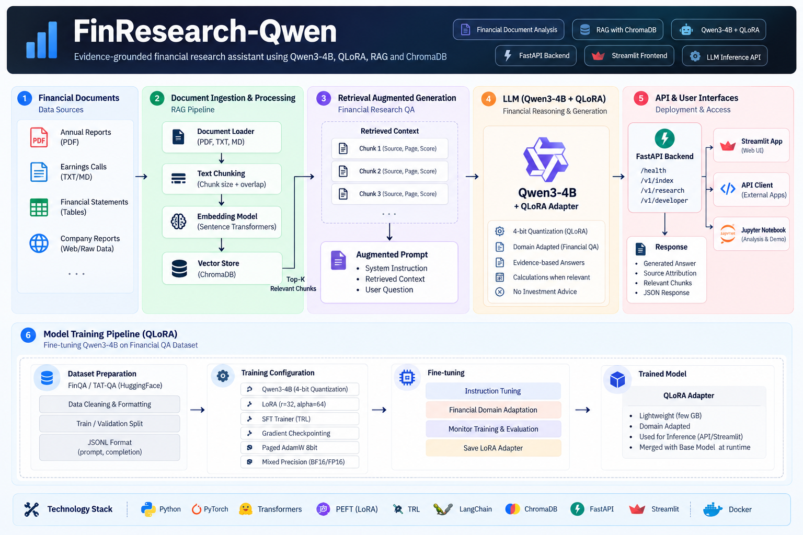
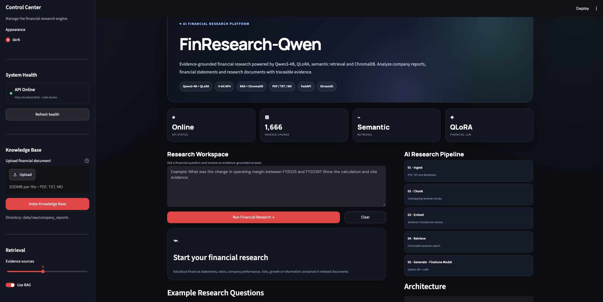
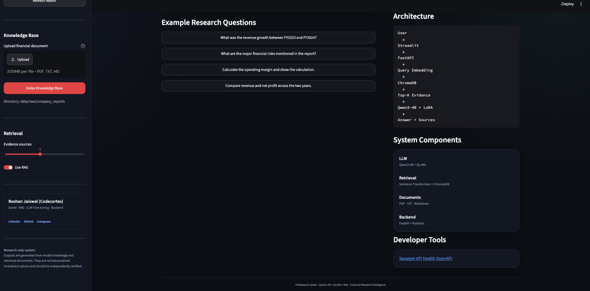

#  FinResearch-Qwen

### Evidence-Grounded Financial Research Assistant

FinResearch-Qwen is an end-to-end Generative AI project combining
**Qwen3-4B, QLoRA fine-tuning, RAG, ChromaDB, FastAPI, Streamlit, and
Docker** to build a financial research assistant.



##  Features

-   🧠 **Qwen3-4B + QLoRA** for financial-domain adaptation
-   🔎 **RAG** for PDF, TXT and Markdown financial documents
-   📚 **ChromaDB** semantic vector search
-   📊 Dataset preparation and LLM evaluation
-   ⚡ **FastAPI** backend with Swagger/OpenAPI
-   🎨 **Streamlit** UI 
-   🐳 **Docker Compose** deployment
-   🔗 Evidence and source-aware responses

##  Architecture

``` text
Financial Documents
       ↓
 PDF / TXT / MD
       ↓
 Parsing + Chunking
       ↓
 Embeddings
       ↓
 ChromaDB
       ↓
 Top-K Retrieval
       ↓
 Qwen3-4B + QLoRA
       ↓
 Evidence-Grounded Answer
       ↓
 FastAPI → Streamlit
```

## 📂 Project Structure

``` text
finresearch-qwen/
│
├── api/                  # FastAPI backend and REST API
├── artifacts/            # Generated model and RAG artifacts
├── data/                 # Training datasets and financial documents
├── deployment/           # Docker and deployment configuration
├── docs/                 # Project documentation and architecture
├── notebooks/            # Data, training, evaluation and API notebooks
├── src/                  # Core AI, RAG, training and inference modules
├── streamlit_app/        # Streamlit frontend
│
├── .env.example          # Environment variable template
├── .gitignore            # Git ignored files
├── command.txt           # Useful project commands
├── LICENSE               # Project license
├── README.md             # Project documentation
└── requirements.txt      # Python dependencies
```

## ⚙️ Quick Start

``` bash
git clone https://github.com/CodeCortex/finresearch-qwen.git
cd finresearch-qwen

python3 -m venv .venv
source .venv/bin/activate
pip install -r requirements.txt
```

Prepare the dataset:

``` bash
python src/data/prepare_dataset.py
```

Run FastAPI:

``` bash
uvicorn api.main:app --host 0.0.0.0 --port 8000
```

Swagger:

`http://localhost:8000/docs`

Run Streamlit:

``` bash
streamlit run streamlit_app/app.py
```

Frontend:

`http://localhost:8501`





## 🧪 Training & Evaluation

``` bash
python src/training/train_qlora.py
python src/evaluation/benchmark.py --limit 100
```

QLoRA training requires an NVIDIA CUDA environment in the current
configuration.

## 🛠️ Tech Stack

**Python · PyTorch · Qwen3-4B · QLoRA · LoRA/PEFT · Transformers · TRL ·
ChromaDB · Sentence Transformers · FastAPI · Streamlit · Docker**

## 🎯 Generative AI Concepts

**LLM Fine-Tuning · QLoRA · RAG · Embeddings · Vector Search · Prompt
Engineering · LLM Evaluation · REST APIs · AI Deployment**

## ⚠️ Disclaimer

FinResearch-Qwen is a research and educational AI system. It is **not
financial advice** and should not be used as the sole basis for
investment decisions.

## 👨‍💻 Author

**Roshan Jaiswal --- CodeCortex**

Generative AI • LLMs • RAG • Backend Engineering • AI Applications

⭐ If you find this project useful, consider starring the repository.
